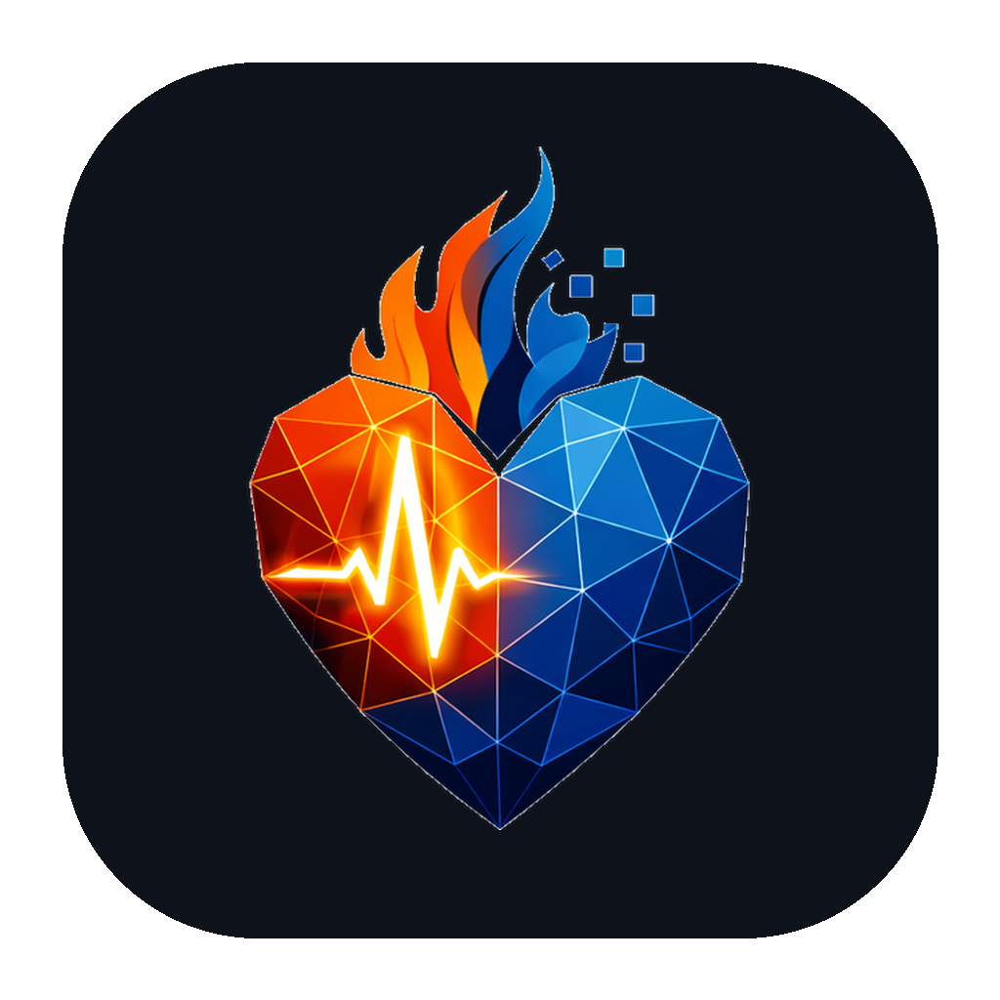

<p align="center">
  
</p>

<h1 align="center">TorchCor Lighting</h1>

<p align="center">
  Set up, run and explore GPU cardiac simulations with <a href="https://github.com/sagebei/torchcor">TorchCor</a>, without writing code.
</p>

TorchCor Lighting is a desktop app for Windows, macOS and Linux. Choose what to simulate
(electrophysiology, a 12-lead ECG, mechanics, electromechanics or your own TorchCor
script), set its parameters or start from a demo, and run it on this computer or on a GPU
server over SSH. Each run is a plain, readable TorchCor script in its own folder on that
machine: the app follows it live, keeps going when you close it, and brings the results
back as interactive views. The app itself never needs PyTorch.

## Install

Download the file for your computer from the
[latest release](https://github.com/sagebei/torchcor_lighting/releases/latest) (the file
names stay the same from one version to the next):

| Computer | File | Then |
|---|---|---|
| Windows 10 or 11 | `TorchCor-Lighting-windows-x64-setup.exe` | Run it. It asks whether to install for you only (no administrator rights needed) or for all users. |
| Ubuntu 22.04 or newer, Debian 12 or newer | `TorchCor-Lighting-linux-x86_64.deb` | `sudo apt install ./TorchCor-Lighting-linux-x86_64.deb` |
| Mac with Apple silicon | `TorchCor-Lighting-macos-arm64.dmg` | Open it and drag the app to Applications. |
| Mac with an Intel processor | `TorchCor-Lighting-macos-x86_64.dmg` | Open it and drag the app to Applications. |

Portable copies need no installation: unzip the Windows `.zip` and run `TorchCor Lighting.exe`,
or unpack the Linux `.tar.gz` and run `./torchcor-lighting` (`./install.sh` adds a menu entry).

The apps are not signed yet. Windows SmartScreen may say that it protected your PC: choose
More info, then Run anyway. macOS blocks the first start: allow it under System Settings →
Privacy & Security → Open Anyway.

Or run it from source with [uv](https://docs.astral.sh/uv/):

```bash
uv tool install git+https://github.com/sagebei/torchcor_lighting
torchcor-lighting
```

A machine that runs simulations needs Python 3.10 or newer with PyTorch for its GPUs; the
app installs TorchCor (1.9 or newer) into that environment for you.

## Development

```bash
pip install -e ".[dev]"
pytest -m "not slow"                    # headless test suite
ruff check .
python packaging/build.py --archive     # build the app and its installers
```

[docs/ARCHITECTURE.md](docs/ARCHITECTURE.md) explains how the pieces fit together.

## License

[MIT](LICENSE)
